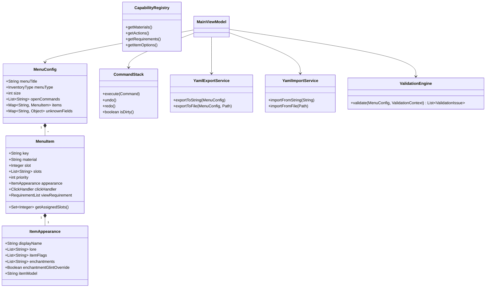

# DeluxeMenus Studio

> **DeluxeMenus Studio** — автономное десктопное WYSIWYG-приложение для визуального проектирования, редактирования и кодогенерации конфигурационных файлов плагина **DeluxeMenus** (Minecraft Paper / Spigot / Purpur).

---

## 🚀 Возможности

- **Визуальная сетка инвентаря (WYSIWYG)**:
  - Поддержка размеров от 9 до 54 слотов (CHEST, HOPPER, DROPPER, DISPENSER, FURNACE, ANVIL, WORKBENCH).
  - Drag & Drop перемещение и копирование предметов (с удержанием `Ctrl`).
  - Быстрые шаблоны раскладки в один клик: периметр из стекла, шахматный порядок, очистка.
  - Поддержка нескольких предметов на одном слоте с разными приоритетами (`priority`) и подсветка коллизий.
- **Инспектор предмета**:
  - Автодополнение ванильных материалов Minecraft 1.16–1.21.x и поддержка префиксов (`head-`, `basehead-`, `texture-`, `hdb-`, `itemsadder-`, `oraxen-`, `nexo-`, `mmoitems-`, `placeholder-`).
  - **Живой предпросмотр тултипа** в оригинальном стиле Minecraft (`TextFlow`) с интерпретацией цветовых кодов `&0`–`&f`, стилей `&l/&o/&n/&m/&k/&r` и HEX-цветов `&#rrggbb`.
  - Редактор флагов предмета (Item Flags: `HIDE_ENCHANTS`, `HIDE_ATTRIBUTES`, `HIDE_UNBREAKABLE` и др.).
  - Редактор зачарований, RGB-цветов, отделки брони (`trim_material` + `trim_pattern`), метаданных баннеров и зелий.
  - Версионно-зависимые поля (`item_model`, `model_data_component`, `tooltip_style`, `enchantment_glint_override`, `hide_tooltip`).
- **Конструктор действий и условий**:
  - Действия по клику для всех типов: `click_commands`, `left_click_commands`, `right_click_commands`, `shift_left_click_commands`, `shift_right_click_commands`, `middle_click_commands`.
  - Модификаторы `<delay=ticks>` и `<chance=percent>` задаются удобными полями ввода.
  - Конструктор условий (`has permission`, `has money`, `string equals`, `javascript` и др.) с поддержкой инверсии (`type: "!..."`), `minimum_requirements` (логика OR) и `stop_at_success`.
- **Живой предпросмотр кода и экспорт**:
  - Панель живого кода YAML с debounce (150–250 мс) и копированием в буфер обмена.
  - Строгая сериализация SnakeYAML: одинарные кавычки для защиты `&` и `!`, отсутствие разрывов длинных строк lore, UNIX LF.
  - Сохранение в файл в кодировке UTF-8 строго без BOM.
- **Обратная совместимость и Reverse Engineering (Импорт)**:
  - Открытие любого существующего `.yml` файла DeluxeMenus.
  - Сохранение неизвестных приложению ключей (`unknownFields`) — чужой конфиг не теряет кастомные поля при round-trip.
  - Автоматическая миграция устаревших опций (`data` -> `damage`, `hide_enchantments` -> `item_flags`).
- **Интеллектуальная валидация (V-1 ... V-19)**:
  - Панель проблем с переходом к проблемному слоту по двойному клику.
  - Обнаружение коллизий приоритетов, слотов вне диапазона, опечаток в плейсхолдерах `%...%`, клик-условий без команд.
- **Undo / Redo и надежность**:
  - Полная история отмены и повтора операций (Ctrl+Z / Ctrl+Y) глубиной до 50 шагов.
  - Автосохранение черновика каждые 60 секунд в `~/.deluxemenus-studio/autosave_draft.yml`.
  - 100% Offline Standalone — нулевое количество сетевых запросов в рантайме.
  - Полная локализация интерфейса: Русский и English.

---

## 🏛 Архитектура

Приложение построено по паттерну **MVVM (Model-View-ViewModel)** с использованием реактивных свойств JavaFX `Property` / `Binding`.

```
View (FXML + CSS)  ──>  ViewModel (Properties, Commands)  ──>  Model (POJO)
                                    │
                                    └──> Service (Yaml I/O, Registry, Validation)
```

### Диаграмма классов



---

## 📦 Сборка и запуск

### Требования
- **JDK 21 LTS** или выше.
- **Apache Maven 3.8+**.

### Сборка проекта и запуск тестов
```bash
mvn clean test
```

### Запуск в режиме разработки
```bash
mvn javafx:run
```

### Сборка автономного Fat-JAR (со всеми зависимостями)
```bash
mvn clean package
```
Собранный исполняемый файл находится в `target/deluxemenus-studio-1.0.0-SNAPSHOT.jar`.  
Запуск:
```bash
java -jar target/deluxemenus-studio-1.0.0-SNAPSHOT.jar
```
*(Точка входа `Launcher` не наследует `javafx.application.Application`, что решает проблему `Error: JavaFX runtime components are missing`)*.

---

## 🔧 Поддержка новых версий DeluxeMenus и Minecraft

Приложение использует **Capability Registry** — все списки материалов, действий, типов условий и опций вынесены в JSON-дескрипторы в папке `src/main/resources/registry/`:

| Файл дескриптора | Что описывает | Как обновить при выходе новой версии |
|---|---|---|
| `materials-1.21.json` | Каталог материалов, цвета и категории | Добавить новые материалы Mojang |
| `actions.json` | Префиксы действий (`[console]`, `[sound]`...) | Добавить новое действие плагина с подсказкой |
| `requirements.json` | Типы условий и их поля ввода | Добавить новый тип и список полей |
| `item-options.json` | Ключи предметов и версионные метки (`sinceVersion`) | Обновить версию или добавить новую опцию |
| `sounds-1.21.json` | Звуковые идентификаторы | Добавить новые звуки |

Обновление форматов не требует переписывания Java-кода: достаточно отредактировать соответствующий JSON-файл.

---

## 📝 Пример генерируемого YAML (соответствует ТЗ §8.1)

```yaml
menu_title: '&#55ff55&lСерверный Магазин'
open_command:
  - shop
  - store
register_command: true
menu_type: CHEST
size: 27
update_interval: 20

open_requirement:
  requirements:
    not_banned:
      type: '!has permission'
      permission: server.shop.blocked
      deny_commands:
        - '[message] &cДоступ к магазину закрыт.'

items:
  border:
    material: GRAY_STAINED_GLASS_PANE
    slots:
      - 0-8
      - 18-26
    display_name: ' '
    priority: 10

  donate_fly:
    material: FEATHER
    slot: 13
    priority: 0
    update: true
    display_name: '&#ffaa00&lВозможность полета (/fly)'
    lore:
      - '&7Позволяет летать в пределах'
      - '&7основного мира выживания.'
      - ''
      - '&fЦена: &a500 монет'
      - '&7Ваш баланс: &a%vault_eco_balance%'
      - '&eКликните для покупки!'
    item_flags:
      - HIDE_ATTRIBUTES
      - HIDE_ENCHANTS
    enchantment_glint_override: true
    view_requirement:
      requirements:
        no_fly_yet:
          type: '!has permission'
          permission: group.fly
    left_click_requirement:
      requirements:
        enough_money:
          type: has money
          amount: 500
      deny_commands:
        - '[message] &cНедостаточно средств.'
        - '[sound] ENTITY_VILLAGER_NO'
    left_click_commands:
      - '[console] eco take %player_name% 500'
      - '[console] lp user %player_name% permission set group.fly true'
      - '[sound] ENTITY_PLAYER_LEVELUP'
      - '[message] &aПокупка совершена!<delay=5>'
      - '[refresh]'
```

---

## ⚖️ Границы MVP и известные ограничения

### Реализовано в MVP:
- Все глобальные свойства меню (§6.1).
- Визуальная сетка слотов 9–54, Drag & Drop, контекстное меню, пресеты рамки и шахматки (§6.2).
- Инспектор предмета, процедурные векторные иконки, живой тултип с цветами и стилями (§6.3.1–6.3.3).
- Конструктор условий с инверсией `!` и логикой OR (`minimum_requirements`) (§6.3.4).
- Полный импорт существующих файлов с сохранением неизвестных полей `unknownFields` (§6.4).
- Живой предпросмотр YAML на RichTextFX с debounce 200 мс и копированием в буфер (§6.5).
- Undo / Redo на 50 шагов и автосохранение черновиков каждые 60 секунд (§6.6).
- Движок валидации правил V-1 .. V-18 (§9.1).
- Полная двуязычная локализация RU / EN (§7 NFR-5).
- 100% Offline Standalone безопасность (NFR-10).
- Покрытие тестами JaCoCo ≥75% для сервисных пакетов.

### Запланировано в версии 1.1+:
- Режим симуляции профиля игрока с песочницей GraalJS для javascript-условий (§6.8).
- Проект из нескольких взаимосвязанных меню с графом переходов (§6.7).
- Локальное извлечение текстур из пользовательского ресурс-пака (§10.2).
- Библиотека кастомных пользовательских заготовок (§6.9).
