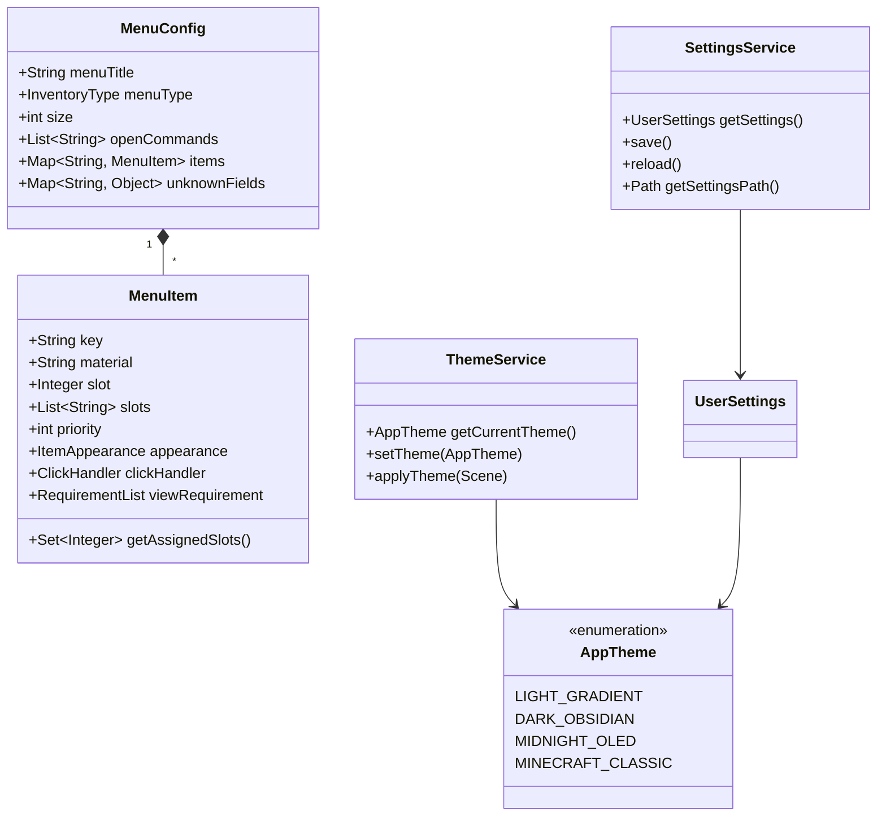

# DeluxeMenus Studio

DeluxeMenus Studio — автономное десктопное WYSIWYG-приложение для визуального проектирования, редактирования и генерации конфигурационных файлов плагина DeluxeMenus (Minecraft Paper / Spigot / Purpur).

Поддерживаются платформы Windows, Linux и macOS. Приложение функционирует полностью автономно в оффлайн-режиме, не совершая внешних сетевых запросов.

---

## Возможности версии 1.1.0

### Кроссплатформенная среда (Windows, Linux, macOS)
- **Универсальный исполняемый файл**: сборка включает платформенные бинарные библиотеки JavaFX для Windows x64, Linux x86_64, macOS Intel и macOS Apple Silicon (M1/M2/M3/M4).
- **Скрипты быстрого запуска**:
  - `run.bat` — для Windows.
  - `run.sh` — исполняемый скрипт для Linux (`chmod +x run.sh`).
  - `run-macos.command` — запуск в один клик для macOS с интеграцией в Dock.
- **Непрерывная интеграция**: GitHub Actions CI/CD пайплайн сборки и верификации на матрице Ubuntu, macOS и Windows.

### Система тем оформления и персонализация
- **Настройка темы в окне параметров (`Ctrl+,` / `Cmd+,`)**:
  - **Dark Obsidian**: современная темная тема в сланцево-графитовых тонах с синими акцентами.
  - **Light Gradient**: светлая градиентная тема с плавным переходом от светло-серого к белому.
  - **Midnight OLED**: сверхконтрастная черная тема с неоновыми бирюзовыми акцентами для OLED-экранов.
  - **Minecraft Classic**: аутентичный стиль классического интерфейса Minecraft с 3D-фасками и ретро-палитрой.
- **Динамическое переключение**: смена темы применяется мгновенно ко всем открытым окнам без необходимости перезапуска приложения.
- **Быстрый выбор**: переключение тем доступно напрямую через меню `Настройки -> Тема оформления`.
- **Сохранение конфигурации**: параметры темы, языка и автосохранения сохраняются в `~/.deluxemenus-studio/settings.json`.

### Визуальный редактор инвентаря (WYSIWYG)
- Поддержка размеров от 9 до 54 слотов (CHEST, HOPPER, DROPPER, DISPENSER, FURNACE, ANVIL, WORKBENCH).
- Drag & Drop перемещение и дублирование предметов с удержанием клавиши `Ctrl` или `Alt`.
- Инструмент «Кисть» для быстрой штамповки выбранного предмета по сетке слотов.
- Быстрые шаблоны раскладки: рамка по периметру, шахматный порядок, заливка пустых слотов, полная очистка.
- Поддержка нескольких предметов на одном слоте с разными приоритетами (`priority`) и визуальная индикация коллизий.

### Инспектор предметов и Minecraft-экосистема
- Автодополнение ванильных материалов Minecraft 1.16–1.21.x и распознавание префиксов (`head-`, `basehead-`, `texture-`, `hdb-`, `itemsadder-`, `oraxen-`, `nexo-`, `mmoitems-`, `placeholder-`).
- **Интерактивный диалог голов**: поддержка базы HeadDatabase и пользовательских Base64-текстур с предпросмотром.
- **Живой предпросмотр тултипа** в оригинальном стиле Minecraft с поддержкой цветовых кодов `&0`–`&f`, стилей `&l/&o/&n/&m/&k/&r` и HEX-градиентов `&#rrggbb`.
- Редактор флагов предмета (`HIDE_ENCHANTS`, `HIDE_ATTRIBUTES`, `HIDE_UNBREAKABLE` и др.).
- Генератор RGB-градиентов с экспортом в форматы DeluxeMenus Legacy, MiniMessage и Spigot.

### Интерактивная симуляция (Play Mode)
- Полнофункциональное окно симуляции кликов (ЛКМ, ПКМ, Shift-клики).
- Проверка условий `view_requirement`, `left_click_requirement`, `right_click_requirement`.
- Процедурный синтез звуков кликов и оповещений.
- Логирование чата, консольных команд и многофайловых переходов `[openguimenu]`.

### Надежность и архитектура
- Строгое соблюдение лимитов архитектуры: размер каждого класса исходного кода не превышает 400 строк.
- 100% паритет ключей локализации между русским (`messages_ru.properties`) и английским (`messages_en.properties`) языками.
- Автономность: нулевое количество сетевых вызовов в рантайме (NFR-10).
- Полная история отмены и повтора (Undo/Redo) глубиной до 50 шагов.

---

## Архитектура

Приложение построено по архитектурному паттерну **MVVM (Model-View-ViewModel)** с реактивным связыванием свойств JavaFX.

```
View (FXML + CSS)  ──>  ViewModel (Properties, Commands)  ──>  Model (POJO)
                                    │
                                    └──> Service (Settings, Theme, Yaml I/O, Registry)
```

### Диаграмма сервисов и моделей



---

## Сборка и запуск

### Системные требования
- **Java Development Kit (JDK) 21 LTS** или выше.
- **Apache Maven 3.8+**.

### Сборка и запуск тестов
```bash
mvn clean test
```

### Сборка универсального Fat-JAR
```bash
mvn clean package -DskipTests
```
Собранный универсальный JAR-файл находится по пути:
`target/deluxemenus-studio-1.1.0.jar`

### Запуск приложения

#### Windows
Запустите `run.bat` двойным кликом или выполните в консоли:
```cmd
run.bat
```

#### Linux
Сделайте скрипт исполняемым и запустите его:
```bash
chmod +x run.sh
./run.sh
```

#### macOS
Запустите `run-macos.command` двойным кликом в Finder или через терминал:
```bash
chmod +x run-macos.command
./run-macos.command
```

#### Прямой запуск через Java
```bash
java -jar target/deluxemenus-studio-1.1.0.jar
```

---

## Структура реестров и расширяемость

Все метаданные версий Minecraft вынесены в оффлайн JSON-реестры в папке `src/main/resources/registry/`:

| Файл реестра | Назначение |
|---|---|
| `materials-1.21.json` | Каталог материалов, цвета и категории предметов |
| `actions.json` | Поддерживаемые типы действий (`[console]`, `[message]`, `[sound]`...) |
| `requirements.json` | Типы условий проверки и их параметры |
| `papi-catalog.json` | Встроенный оффлайн-справочник PlaceholderAPI |
| `heads-catalog.json` | Встроенный каталог популярных голов игроков и декораций |

---

## Лицензия

Проект распространяется под лицензией MIT. Исходный код открыт для модификации и интеграции.
